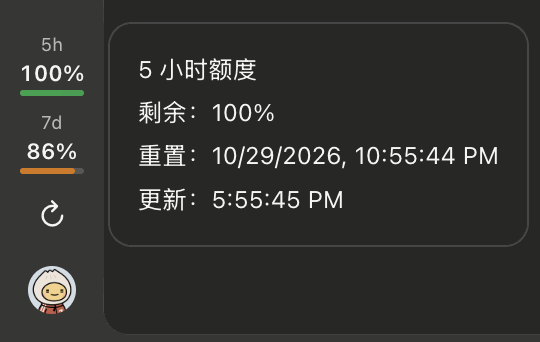

# Codex Sidebar Usage

**Latest release: v0.3.1** · [Releases](https://github.com/jaymengxy/codex-sidebar-usage/releases)

[](README.md) [](README.zh-CN.md)

A lightweight, unofficial macOS utility that displays your **Codex usage limits directly in the left navigation bar of the ChatGPT desktop app**.

See how much of your five-hour and weekly quota remains without opening the usage settings.

> This is an independent project, **not affiliated with or endorsed by OpenAI**. It uses an unsupported desktop debugging interface and may need updates when ChatGPT changes.

## Language support

The macOS Launcher, terminal output and build/install messages automatically display **Chinese when macOS prefers a Chinese language**, or **English for other system languages**. The quota panel inside ChatGPT prefers the app renderer's declared language, falling back to the system/browser language when unavailable. No language setting is required. A separately chosen ChatGPT language may not always be reflected in the page's `lang` attribute.

This feature is currently in development on `feat/i18n-v0.3.2` and is **not part of the published v0.3.1 release**.

## Features

- **Quota at a glance:** five-hour (5h) and weekly (7d) remaining percentages.
- **Color-coded progress:** green for the five-hour quota and orange for the weekly quota.
- **Reset details:** click a quota to view its remaining percentage, reset time, and last update. Click outside the panel or press **Esc** to close it.
- **Refresh controls:** click ↻ to check for updated usage; the display also refreshes periodically and when you return to it.
- **Automatic recovery:** the indicator comes back after the ChatGPT window reloads.
- **Two ways to run:** use a single Terminal command, or build a native macOS Launcher that you can open from Finder or the Dock.

The percentages come from a Codex usage snapshot, so they may not change immediately after every request. If a quota window is unavailable, the indicator displays `--`.

## Preview



## Before you start

- **macOS 13 or newer**, with ChatGPT installed at `/Applications/ChatGPT.app`.
- **Node.js 22 or newer**. Check with `node --version`.
- For the native Launcher only: **Xcode Command Line Tools**. Install with `xcode-select --install` if needed.
- Access to a working Codex CLI/App Server account. The CLI used by this utility should be signed into the account whose usage you want to display.

No third-party npm packages are required.

### Download

```bash
git clone https://github.com/jaymengxy/codex-sidebar-usage.git
cd codex-sidebar-usage
git switch main
```

The released Launcher is available on `main`. The repository must be accessible to your GitHub account.

## Option 1 — Start from Terminal

This is the quickest way to try the indicator.

1. Quit ChatGPT completely with **Cmd+Q**.
2. Open Terminal in the project folder and run:

```bash
npm run launch
```

The command opens ChatGPT with the connection needed for the sidebar indicator and starts monitoring usage. **You do not need to enable CDP or debugging settings manually.**

Keep this Terminal window open while using the indicator. To stop monitoring, press **Ctrl+C**. ChatGPT itself remains open.

If ChatGPT is already open normally, quit it before running the command so the launcher can start it with the required connection.

## Option 2 — Build a native macOS Launcher

Use this option if you prefer a regular macOS application that you can double-click without leaving Terminal open.

### Build and install

From the project folder, run:

```bash
npm run launcher:build
npm run launcher:install
```

Then quit any normally running ChatGPT instance and open the Launcher:

```bash
open "$HOME/Applications/Codex Usage Launcher.app"
```

You can also open **Codex Usage Launcher.app** from Finder or drag it into the Dock.

The Launcher automatically starts ChatGPT and the usage monitor. Its window includes **Start Monitor**, **Stop Monitor**, **Select Node…**, **Select Codex…**, and a diagnostic log.

- Closing the Launcher window keeps monitoring active; click its Dock icon to reopen the window.
- Choosing **Stop Monitor** or quitting the Launcher with **Cmd+Q** stops its monitoring process, but does not quit ChatGPT.
- To use a different Node.js or Codex CLI executable, select it from the Launcher window.
- After updating the project source, run `npm run launcher:build` and `npm run launcher:install` again.

The Launcher bundles the monitoring scripts but uses the locally installed Node.js and Codex CLI. It does not alter the ChatGPT application.

### Launcher icon

When you build the app, the installer creates its icon from the ChatGPT icon **already installed on your Mac**, with two small green and orange bars in the lower-left corner. The bars are a visual identifier, not a live quota display. The original ChatGPT icon is not included in this repository.

If the Dock still shows an older icon, quit the Launcher, remove its existing pinned Dock item, then drag `~/Applications/Codex Usage Launcher.app` from Finder into the Dock. If needed, run `killall Dock` to restart Dock without resetting its layout.

To uninstall the Launcher application:

```bash
npm run launcher:uninstall
```

This removes the utility from `~/Applications`, not ChatGPT or your account data.

## Which option should you use?

| | Terminal | Native Launcher |
| --- | --- | --- |
| Best for | Trying the utility, development | Everyday use |
| Setup | Node.js 22+ | Node.js 22+ and Xcode Command Line Tools |
| Start | `npm run launch` | Double-click Launcher.app |
| Keep Terminal open | Yes | No |
| Stop monitoring | Ctrl+C | Stop Monitor or Cmd+Q |
| Recover after window reload | Yes | Yes |

Both options automatically start ChatGPT with the local debugging connection the indicator needs.

## Troubleshooting

**ChatGPT is already running, but the indicator won't start.** Quit ChatGPT with **Cmd+Q**, then open it through `npm run launch` or the native Launcher. Starting ChatGPT normally does not enable the indicator's debugging connection.

**The Launcher cannot find Node.js or Codex.** Check `node --version` and `command -v codex` in Terminal. Use **Select Node…** or **Select Codex…** in the Launcher to choose the executable, then start monitoring.

**The indicator doesn't appear.** Make sure the ChatGPT main window is open, the monitoring process is running, and you haven't started a second copy of the monitor. If necessary, quit ChatGPT and relaunch it through one of the two options above.

**The percentages differ from ChatGPT's usage page.** You can run `npm run probe` from the project folder to read a quota snapshot without opening ChatGPT. Check that the Codex CLI uses the intended account. Usage information may be delayed.

**Can I start the utility when I log in to macOS?** The project includes a separate, optional LaunchAgent-based login workflow for advanced users. It should not run alongside the native Launcher. Refer to the [architecture notes](docs/architecture.md) before enabling it.

## Advanced — Connect to an existing CDP-enabled ChatGPT

**You can skip this section when using either recommended startup option above.**

The utility connects to ChatGPT through the Chromium DevTools Protocol (**CDP**) on the loopback-only port `127.0.0.1:9238`. ChatGPT does not normally start with this port enabled; both launch options enable it automatically.

If you specifically want to start ChatGPT yourself and attach the monitor separately:

1. Quit ChatGPT completely.
2. In one Terminal, start ChatGPT with CDP enabled:

```bash
/usr/bin/open -a "/Applications/ChatGPT.app" --args \
  --remote-debugging-address=127.0.0.1 \
  --remote-debugging-port=9238
```

3. In another Terminal, from the project folder, run:

```bash
npm start
```

Keep `npm start` running to maintain usage updates. This manual two-process setup is intended for advanced use; it is not required for normal installation.

## Privacy, security and compatibility

- CDP grants broad local debugging access. Keep it bound to **127.0.0.1**; never expose it on your network.
- Usage data is read through Codex App Server's read-only `account/rateLimits/read` method. The project does not copy authentication files or place login tokens in the ChatGPT interface.
- The native application is built and locally signed on your Mac. It is not notarized for public software distribution.
- ChatGPT's internal interface may change. Compatibility with future releases is not guaranteed.

[Architecture](docs/architecture.md) · [Compatibility](docs/compatibility.md) · [Changelog](CHANGELOG.md)
